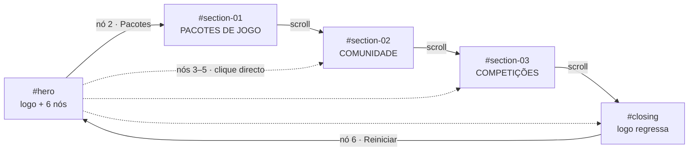

# CLONE_SPEC — Forge Automotive → Arsenal Gaming Hub

> **Revisão 4 (hero — prevalece sobre a Parte B).** A hero de referência é a secção **“Our Approach To Every Build”** (`sc-e85696e3-0`, imediatamente após os dois primeiros textos), **não** a Identity (`sc-3a017878-0`). Composição: H2 topo-esquerdo, marquee bottom-left, parágrafo/CTA bottom-right, fundo full-bleed desfocado, logo Arsenal à direita. Ver `DIFF_REPORT.md` §18.

> **Revisão 2 (feedback do utilizador — prevalece sobre a Parte B).**
> A paleta é **exclusivamente preto/branco/cinzas**: `--ember` e `--gold` foram removidos, tal como todos os gradientes/glows avermelhados.
> As três secções são **split 50/50 — texto à esquerda, imagem à direita, a 100svh** (estilo das secções split da página original), com imagens reais convertidas para grayscale; não são painéis full-bleed centrados.
> Os cortes da logo são os **ficheiros fornecidos pelo utilizador** (`arsenal-ring.svg`, `arsenal-a.svg`), aplicados como máscaras CSS e recoloridos a `--paper`.
> A navbar minimalista (marca + “Entrar”) é um requisito adicional. Onde a Parte B contradiz esta revisão, a revisão prevalece.

> **Fase 1 — Extracção.** Documento de referência técnica do site `https://forgeautomotive.co.uk/` (analisado em 2026-11-08) e especificação da landing page Arsenal que o vai reutilizar.
> Todos os valores marcados como **extraídos** foram medidos no DOM/CSSOM computado, nas folhas de estilo carregadas, no HTML servido e nas capturas. Valores marcados **decisão** são escolhas de design para o Arsenal (não existem no original). Onde não foi possível determinar, está `[NÃO DETERMINADO]` com a razão.

## 0. Proveniência da análise

| Item | Valor |
|---|---|
| Ferramenta | REA `capture_browser_scenario` (Chromium 157.0.8103.38, Playwright), + sondagens CDP de estilos computados e CSSOM |
| Evidence IDs | `ev_fe352c789b3fc3b2b937c25b151d409469bda974d80274179000d92d83762b06` (gate de cookies), `ev_05c75e3e5c72f201ff519df9899a079da1fdcaa532f8d1567b79bd6585983025` (site entrado) |
| Viewports | 1440×900, 1024×768, 768×1024, 390×844; DPR 1; `en-GB`; `prefers-reduced-motion: no-preference` |
| Artefactos locais | `.rea/site/page.html` (DOM pós-hidratação), `.rea/site/*.png` (capturas), `.rea/site/rules.json` + `matched2.json` (regras CSSOM), `.rea/site/responsive.json`, `.rea/site/ax.txt` |
| Limitações | Conteúdo de Sanity é servido por RSC; os vídeos heróis usam um formato binário proprietário `.af` bloqueado por CORS → não decodificado. Configuração GSAP está minificada → só valores observáveis. |

---

# PARTE A — Extracção do original

## 1. Stack e tecnologias

| Camada | Detecção | Evidência |
|---|---|---|
| Framework | **Next.js 16** (App Router, React Server Components, Turbopack) | `self.__next_f`, chunks `turbopack-*.js`, `<html lang="en-GB">`, `next-route-announcer` |
| UI runtime | **React 19** | payload RSC `self.__next_f.push`, hidratação |
| CMS | **Sanity** | `ed72g2cx.api.sanity.io` (EventSource live), `cdn.forgeautomotive.media`, atributo `data-sanity=...base=https://forge-automotive.netlify.app/studio`, `@sanity/image-url` no bundle |
| Deploy | **Netlify** (studio), domínio próprio com CDN `cdn.forgeautomotive.media` | `data-sanity` base URL |
| CSS | **styled-components** (CSS-in-JS) + folha global de reset + *custom element* `<waffl-grid>` | classes `sc-<hash>-<n>` + classe gerada (ex.: `iZWByV`), `<waffl-grid>` |
| Framework CSS | **Nenhum** (sem Tailwind/Bootstrap). Reset/base próprio + variáveis CSS | `2cf1_565uvy1t.css` (5 752 B), `2fdd_lc5jd195.css`, `19rhlcx2srev9.css` |
| Animação | **GSAP 3** + **ScrollTrigger** + **SplitText** (bundled) | identificadores `GSAP`, `scrollTrigger`, `SplitText`, `power3.out`, `expo.` nos chunks |
| Scroll suave | **Lenis** (`window.lenis`, contentor `.lenis` com `overflow:auto`) | `window.lenis` object; `main#page > .lenis` |
| Vídeo herói | **ActiveFrame.js** proprietário — sequências de frames binárias `.af` | `https://forgeautomotive.co.uk/ActiveFrame.js`; erros CORS para `*.af` |
| Fontes | **GeistSans** variável (100–900) + **editorial** serif (200, 200 italic, 300), ambas *self-hosted* | `@font-face` em `2fdd_lc5jd195.css` |
| Ícones | SVG inline | `<svg class="sc-3148f3ed-0 fsIQRU">` |
| Analytics | **Google Analytics** | cookies `_ga`, `_ga_5NECT653LD`; `forge_consent` |
| Outros terceiros | Sanity live events | `text/event-stream`, `tag=next-loader.live.cache-components` |
| Bibliotecas de UI/gráficos/mapas | Nenhuma detectada | — |

## 2. Design system

### 2.1 Cores (valores exactos)

| Token | Valor | Uso observado |
|---|---|---|
| `--brand-bc1` | `#0C0C0C` | fundo de secções (statement, CTA), fundo de media |
| `--brand-bc2` | `#161616` | fundo da secção carrossel (identity), `#page` |
| `--brand-bc3` | `#410306` | fundo do overlay de menu (`nav#site-menu`); borda de foco de botão |
| `--brand-bc4` | `#C5A064` | dourado de marca (tokens; não visível na homepage) |
| `--brand-bc5` | `#F2F1ED` | texto principal, títulos CTA, barra de progresso |
| `--global-white` | `#ffffff` | texto base (`* { color: var(--white) }`), ícones sociais |
| `--global-black` | `#000000` | gradientes, fundo do footer |
| `--feedback-positive` | `#3adb76` | feedback |
| `--feedback-negative` | `#cc4b37` | **aresta vermelha do fill animado dos títulos** |
| `--feedback-warning` | `#face10` | feedback |
| Texto secundário | `color-mix(in srgb, var(--brand-bc5) 80%, transparent)` | parágrafos |
| Texto terciário | `color-mix(in srgb, var(--brand-bc5) 60%, transparent)` | kicker "ARE YOU READY TO" |
| Hairline | `color-mix(in srgb, var(--brand-bc5) 10%, transparent)` | bordas de botões; linha da barra de progresso sobre branco 10% |

Gradientes/sombras extraídos:
- `ktTCgb::after` — `linear-gradient(to top, #000 0%, transparent 50%)`, opacidade `0.4`.
- `hUxulM::after` — idem, opacidade `1`.
- `kESbul::after` (closing) — `linear-gradient(to bottom, #000 0%, transparent 50%)`.
- Sem `box-shadow` em toda a página; profundidade por `filter: blur()`, `mix-blend-mode: screen` e gradientes.
- Glow do anel de botão: `conic-gradient(... white ...)`, `mix-blend-mode: screen`, animação `gradient-angle 4.5s linear infinite`.

### 2.2 Tipografia

`html { font-size: 62.5% }` → **1 rem = 10 px** (1600px+: 68.75%; 1920px+: 75%).

| Papel | Família | Tamanho / line-height | Peso | Letter-spacing | Outros |
|---|---|---|---|---|---|
| H1 herói | `editorial` (serif) | 90 px / 108 px | 200 | −2 px | `text-transform: capitalize` |
| H2 herói | `editorial` | 80 px / 96 px | 200 | −1 px | capitalize |
| Título de secção (H2/H3) | `editorial` | **96 px / 115.2 px** (≥1200); 58 px / 69.6 px abaixo | 200 | −2 px | capitalize |
| "Ends Here" | `editorial` | 140 px / 154 px | 200 | −2 px | — |
| Eyebrow `01 / 03` | `editorial` | 24 px / 28.8 px (≥1200); 20 px / 24 px | 300 | −0.5 px | `font-style: normal`, capitalize |
| Body | `GeistSans` | 18 px / 25.2 px (≥700); 16 px / 22.4 px | 300 | −0.5 px | `text-wrap: balance` (≥1024) / `pretty` |
| Botão | `GeistSans` | 10 px / 20 px (≥700); 9 px | 600 | **3 px** | uppercase |
| Kicker / Navigate / Back to Top | `GeistSans` | 10 px / 20 px; 9 px | 600 | 3 px | uppercase |
| Copyright/menu small | herda body | — | — | — | — |

Fallbacks: `--font-heading: var(--editorial), Georgia, Times, "Times New Roman", serif`; `--font-body: var(--font-geist-sans), Arial, Helvetica, "Liberation Sans", sans-serif`. Fallbacks sintéticos com `ascent-override`/`size-adjust`.

### 2.3 Espaçamento, grelha, raios, z-index

| Token | Valor |
|---|---|
| `--space-s/m/l/xl` | 4.8 / 6 / 10 / 12 rem |
| `--gap-xxs`…`--gap-massive` | 0.2, 0.4, 0.8, 1.6, 2.4, 3.2, 4, 6.4, 8, 9.6, 12.8 rem |
| `--gap-col` | `calc(8.333vw + 1.6rem)` |
| `--br-xs/s/m/l/round` | 0.3 / 0.6 / 1.2 / 1.8 / 999 rem (reservados; a UI é toda a 0 px) |
| `--time-s/m/l` | 0.15 / 0.3 / 0.6 s |
| `--easing-bezzy` | `cubic-bezier(0.8, 0, 0, 1)` |
| `--easing-bezzy2` | `cubic-bezier(0.430, 0.195, 0.020, 1)` |
| `--easing-bezzy3` | `cubic-bezier(0.5, 0, 0, 1)` |
| `--easing-ease` | `ease-in-out` |
| Grelha `waffl-grid` | 4 col <700; 6 col 700–1023; **12 col ≥1024**; gutter 24→32 px; margem 24→32→16 px; coluna ≈88 px @1440 |
| z-index | header `1000`; progresso `997`; fade de página `996`; secções `1–5`; media `−1/−2` |
| Header | fixo; altura **100 px** @1440; 88 px @768; 72 px @390 |
| Barra de progresso | fixa, `2px`, inset 16 px, fundo branco 10%, fill `--brand-bc5`, `scaleX(progress)` |

### 2.4 Reset/base relevante

```css
*{box-sizing:border-box;-webkit-font-smoothing:subpixel-antialiased;text-rendering:geometricprecision;margin:0;padding:0}
html{font-size:62.5%;interpolate-size:allow-keywords}
html,body{height:100%;overflow:hidden}
body{line-height:1}
#page{height:100%;overflow:hidden;position:relative}
*{scrollbar-width:none}
*{color:var(--white)}
.site-nav,.sr-only{clip:rect(0,0,0,0);...}
```

## 3. Estrutura e layout

### 3.1 Árvore de secções (topo lógico, @1440)

| # | Elemento | Altura | Layout / função |
|---|---|---|---|
| 0 | Barra de progresso | 2 px fixos | `scaleX` 0→1 |
| 1 | Intro (vídeo + manifesto) | 3 160 px | vídeo em painel sticky; H2 "We don't modify vehicles / We build them for you" (80 px); H1 "For Those Who Refuse Ordinary" (90 px); body; imagem de costura |
| 2 | "Our Approach To Every Build" | (dentro do intro) | H2 96 px; marquee de 14 logótipos de marcas (120×60); parágrafo + CTA; painel sticky |
| 3 | **Carrossel "Identity / Insight / Cohesion"** | **2 700 px** | 3 slides sticky de 100 dvh; media quadrada 448×448 à esquerda (cols 3–6), texto à direita (cols 8–10); fundo full-bleed desfocado a 0.4 de opacidade |
| 4 | Statement "A vehicle should say…" | 900 px | H2 80 px cols 2–8; imagem 328 px (ratio 2/3) cols 8–10 com parallax; body cols 2–6 |
| 5 | Serviços | 5 400 px | 6 slides sticky: texto à esquerda, imagem full-height à direita; eyebrow "Service", H3, body, CTA |
| 6 | "Ordinary Ends Here" | 2 584 px | tipografia enorme (140 px), 3 imagens em sequência |
| 7 | **Previous Builds** | **900 px** | CTA full-bleed: fundo imagem + gradiente (0.4), título 96 px centrado, body 448 px, botão ghost, `padding-top:50dvh` |
| 8 | **Available Stock** | **900 px** | Idêntica, gradiente a 1.0 |
| 9 | **Closing "Refuse Ordinary"** | **900 px** | fundo imagem escondido por scroll, fundo preto; kicker, H2 96 px em 2 linhas, CTA, "Back to Top" |
| — | Footer real | `sr-only` | nav Home/Builds/Stock/Contact/Legal/Sitemap (invisível, acessível) |

**Mapeamento para o pedido:** o "8.º/9.º/10.º" visual da página corresponde aos três painéis full-bleed consecutivos **Previous Builds → Available Stock → Refuse Ordinary**. São esses três que a landing Arsenal reproduz (3 painéis).

### 3.2 Layout por secção (valores exactos)

**Carrossel identity (referência da hero):**
- `section`: `min-height: count × 100dvh` (3×900 = 2700); `background: #161616`; `overflow: clip`.
- `aside` media: `position:absolute; inset:0; z-index:2; display:block` (≥1024); interior sticky 100 dvh com 3 `picture` sobrepostas (`position:absolute; inset:-1.6rem`), `img { opacity:0.4; filter:blur(0.8rem); object-fit:cover }`.
- Grelha 12 col, gutter 32, margem 16: media `grid-column: 3 / 7` (≥1400) → 448 px; texto `grid-column: 8 / 11` → 328 px.
- Bloco de texto: `height: calc(33.333vw − 3.2rem)` = 448 px @1440; `display:flex; flex-direction:column; justify-content:space-between`; eyebrow no topo; bloco heading+body ao centro; CTA no fundo.
- Media quadrada `aspect-ratio: 1/1`; slides internos com `clip-path: inset(50%)` → `inset(0)` na transição.
- CTA: `padding: 16px 32px`, borda 1 px branco 10%, fundo preto 10%, `backdrop-filter: blur(4px)` (≥1024), 54 px de altura.

**Painéis full-bleed (referência dos 3 painéis):**
- `height: 100dvh; padding-top: 50dvh; background:#0C0C0C; overflow:clip`.
- `::after`: `linear-gradient(to top,#000,transparent 50%)`, opacidade 0.4 (builds) ou 1.0 (stock).
- Fundo: `div` `position:absolute; inset:0; z-index:-1`, imagem `object-fit:cover; object-position:center` + parallax vertical.
- Conteúdo: 50 dvh, flex centrado; H2 96 px centrado; body 18 px, `grid-column: 5/9` (448 px); botão ghost centrado; `margin-bottom` 8 px no título e 32 px no body.
- Fecho: kicker 10 px/3 px/uppercase; H2 96 px; CTA; botão "Back to Top" absoluto a 40 px do fundo.

### 3.3 Breakpoints

| Breakpoint | O que muda |
|---|---|
| `≥420` | margem/gutter da grelha para 32 px; logo top 32 px; padding do header 32 px |
| `≥700` | grelha 6 col; body 18 px; botão 10 px |
| `≥1024` | grelha 12 col; header nav visível; carrossel passa a sticky com media full-bleed; layout split; CTA backdrop-blur; H3 96 px (a partir de 1200); secções 100 dvh |
| `≥1200` | títulos 96 px; eyebrow 24 px; colunas de conteúdo mais estreitas |
| `≥1400` | colunas do carrossel 3/7 e 8/11 |
| `≥1600` | root 68.75% |
| `≥1920` | root 75% |
| `max-height:500px` + landscape | menu compacto |
| `hover:hover` + `pointer:fine` | hovers e animações de letras |
| `prefers-reduced-motion:reduce` | animações desligadas |

## 4. Componentes

| Componente | Estrutura | Estados |
|---|---|---|
| **Header** | fixo; nav social esquerda; logo central absoluto; botão "Navigate" direita; telefone só mobile | social escondido no load (`visibility:hidden;opacity:0`); hover em ícones reduz opacidade dos restantes a 0.4 |
| **Logo** | SVG inline `78×36`, `clipPath`, `<g class="icon">` + `<g class="text">`; paths com animação de entrada | estático |
| **Botão ghost** | `<a class="gjuatN"><span>` + letras em `<span>` + `<i>` | default; hover (borda 40%, letras sobem 4em com stagger 20 ms, gradiente cónico 4.5 s); focus-visible (outline tracejado 60%, offset 2); active; `[disabled]`/`[aria-disabled]` opacidade .4 |
| **H2/H3 animado** | `.line` + `.char`; gradiente `background-clip:text` | estado unfilled (`--fill-pos:-16`, branco 18%); filled (branco + aresta `#cc4b37`) |
| **Slide/carrossel** | `aside` + `section` sticky | ativo / inativo (clip-path, fade, blur) |
| **Painel CTA** | fundo + gradiente + conteúdo + botão | em viewport / fora |
| **Barra de progresso** | 2 px; fill `scaleX` | 0 → 1 |
| **Gate de cookies** | `role=dialog`, `aria-modal`, palavras animadas, 2 botões | focus; hover; accept/reject |
| **Menu overlay** | `nav#site-menu` fixed; fundo `#410306`; `figure` SVG; 3 `ul`; small copyright | fechado (`opacity:0`, `visibility:hidden`, `scale:2`, `blur(8px)`); aberto; toggle ícone 3 linhas → X (rotate 1 s) |
| **Ícones sociais** | SVG 16–24 px, links LinkedIn/Instagram/Facebook | hover opacidade |

## 5. Comportamento e interacção

| Efeito | Gatilho | Especificação observada |
|---|---|---|
| Smooth scroll | global | Lenis; contentor `.lenis` (`overflow:auto`), `window.lenis` |
| Revelação de títulos | ScrollTrigger | por linha/carácter; chars de `translateY(120%)` → `0`; gradiente de fill com `--fill-pos` animado até 100, aresta `#cc4b37`; `97deg` |
| Parallax de imagens | scroll | imagens de CTA/footer com `transform: translateY(...)`; imagens de statement com altura 140% e top −20% |
| Slides sticky | scroll | 3 slides de identity + 6 de serviços; `position:sticky` + `clip-path` |
| Logo | load | paths/texto entram animados (inline `transform-origin` nos paths) |
| Botão ghost | hover | borda, letras com `translateY(4em)` e `--play-state` → running; borda cónica |
| Menu | click "Navigate" | overlay `scale(2)→1`, `blur(8px)→0`, `opacity 0→1`; fundo `#410306`; toggle → X |
| Progresso | scroll | `scaleX` 0→1 |
| Página | navegação | `#page::after` fade para preto (`--page-leave-dur:1.2s`) |
| Gate | load | palavras com reveal; botões; cookie `forge_consent` |

Easing/tempos de referência: `--time-s 0.15s`, `--time-m 0.3s`, `--time-l 0.6s`; botão 0.5 s ease-in-out (letras 0.5 s `bezzy2`, stagger 20 ms); menu 0.3 s + delays; rotação do gradiente 4.5 s linear.

## 6. Assets

| Asset | URL / valor | Dimensões / formato | Função |
|---|---|---|---|
| GeistSans variável | `/_next/static/media/Geist_Variable-s.p.0mrjj4bg00-he.woff2` | woff2 100–900 | corpo |
| editorial light | `/_next/static/media/light-s.p.1q4b3b-dtiu5n.woff2` | woff2 300 | títulos |
| editorial ultralight | `/_next/static/media/ultralight-s.p.0zgba-tqx_tb1.woff2` | woff2 200 | títulos |
| editorial ultralight italic | `/_next/static/media/ultralight_italic-s.p.2aups5f54pqez.woff2` | woff2 200 itálico | ênfase |
| Logo | SVG inline `viewBox="0 0 78 36"`, `78×36`, fill branco | vetor | marca |
| Favicon | `/favicon.ico?favicon.24pqam9041g9u.ico` (48×48), `/icon0.svg`, `/icon1.png` (96×96), `/apple-icon.png` (180×180) | ico/svg/png | ícones |
| Manifest | `/manifest.json` | json | PWA |
| OG image | `https://cdn.forgeautomotive.media/images/ed72g2cx/production/44525b49e3b784d25700b232fc13009fbfcf2000-1200x630.jpg?w=1200&h=630` | 1200×630 jpg | Open Graph/Twitter |
| Poster herói | `.../1ebe90ab77d2912275ef15f9ba86fe2fea1f451f-2880x3600.jpg` | 2880×3600 | poster do vídeo, alt "Hands meticulously stitching red" |
| Fundo "Previous Builds" | `.../35c93330a1cd16aa426b7bded4ad225113f7b6db-3840x2160.png` (desktop) | 3840×2160 png | painel CTA |
| Fundo "Available Stock" | `.../2bd7f1455a34d387b7cab13cfe092e2bd89f49fb-2880x1868.jpg` (desktop) | 2880×1868 jpg | painel CTA |
| Fundo fecho | imagem responsiva Sanity (poster `data:image/gif` no DOM; URL real não exposta no snapshot) | `[NÃO DETERMINADO]` | painel de fecho |
| Imagens de serviço | 6 CDN `216×270`, alts: "Matte black Lamborghini", "Forge Lambo Interior", … | 216×270 | slides de serviços |
| Vídeos | `*.af` (`91db00e1….af`, `1edf5550….af`) | binário proprietário | sequências de frames; **bloqueado por CORS** → `[NÃO DETERMINADO]` codec |
| LQIP | data-URI JPEG ~400 B em `--lqip-mobile/desktop` | inline | placeholder blur |

## 7. Dados e rede

- **Sem API JSON pública para o conteúdo**: o HTML vem renderizado por RSC. O único tráfego de dados é o live do Sanity (`text/event-stream`, `/v2026-06-01/data/live/events/production?tag=next-loader.live.cache-components`).
- Sem formulários nem submissões.
- Cookies: `forge_consent` (same_site Lax, secure), `_ga`, `_ga_5NECT653LD`.
- Para o clone: conteúdo estático em `lib/sections.ts`; não há endpoints a replicar.

## 8. Acessibilidade e SEO

- Skip link "Skip to content" → `#page`.
- Landmarks: `banner`, `navigation` ("Social media"), `main#page`, `contentinfo` (sr-only), `nav#site-menu`.
- Foco: botões e links reais; menu `button` "Navigate"; gate `role="dialog" aria-modal="true" aria-label="Welcome to Forge Automotive"`.
- Headings: H1 único "For Those Who Refuse Ordinary"; H2 por secção; H3 por slide/serviço.
- Alts descritivos em todas as imagens; `aria-label` no logo ("Forge home"); `aria-hidden` nas palavras decorativas.
- `prefers-reduced-motion` desliga animações.
- Meta: título `Bespoke Vehicle Builds & Styling | Forge Automotive`; description; canonical; OG/Twitter completos; `theme-color #0c0c0c`; `lang="en-GB"`.

## 9. Conteúdo textual de referência

| Secção | Texto |
|---|---|
| Herói | "We don't modify vehicles / We build them for you" · "For Those Who Refuse Ordinary" · "A luxury automotive atelier for bespoke styling, performance and craftsmanship." |
| Approach | "Our Approach To Every Build" · "Every decision is intentional, every detail has purpose based on your taste, your lifestyle, and your standards." · CTA "Start Your Project" |
| 01 Identity | "Every build begins with the person behind the wheel, shaped around their individual taste, lifestyle, presence and personal sense of identity on the road." |
| 02 Insight | "Exterior, interior and performance are brought together through a considered, detail-led approach, creating one complete and fully resolved vision." |
| 03 Cohesion | "Every modification is chosen with precision, ensuring each detail adds purpose, balance and distinction to the final bespoke automotive build." |
| Statement | "A vehicle should say something before it moves. Every line, material, and finish is considered." · "Our services are shaped with intent, from exterior styling and interior refinement to performance upgrades, detailing and bespoke finishes; each detail sharpens the vehicle's character without overpowering it." |
| Serviços | Bodystyling · Interior · Wheels · Lighting · Exhaust · Protection (textos completos em `.rea/site/ax.txt`) |
| Ordinary Ends Here | "Ordinary" · "Ends Here" · "Complete expressions of taste, intent and individuality, shaped through detail, restraint and presence." |
| Previous Builds | "A collection of previous bespoke builds, shaped by craft, character and the people behind the wheel." · "Explore Builds" |
| Available Stock | "Builds available for purchase, refined with intent, engineered with purpose, and ready to make a statement." · "Browse Stock" |
| Closing | "Are you ready to" · "Refuse Ordinary" · "Start Your Project" · "Back to Top" |

---

# PARTE B — Especificação da landing Arsenal (requisitos do utilizador)

## 10. Requisitos capturados (checklist)

| # | Requisito |
|---|---|
| R1 | A hero segue a "pegada" da 3.ª secção visual do Forge (após os 2 primeiros blocos de texto): fundo ambiente desfocado, composição em grelha, eyebrow, título display enorme, body, CTA. |
| R2 | A logo Arsenal fica **do lado direito** da hero. |
| R3 | A moldura hexagonal em volta da letra **A** roda continuamente em torno da própria letra; a letra permanece estática. |
| R4 | Estética derivada da logo (monocromática preto/branco, geometria hexagonal/circular) e tipografia **Space Grotesk**. |
| R5 | Hover na logo: a rotação **pausa** e **um círculo brilha**. |
| R6 | Cada círculo está associado a uma secção diferente. |
| R7 | Clicar no círculo aceso navega para a secção seguinte. |
| R8 | As secções de destino usam o estilo dos painéis full-bleed 8.º/9.º/10.º do Forge. |
| R9 | São exactamente **3** secções nesse estilo. |
| R10 | Após as 3, no 4.º scroll, a logo **reaparece com a animação**. |
| R11 | Nesse fecho, hover na logo acende **outro** círculo. |
| R12 | Todos os detalhes acima ficam registados (este documento + plano). |

## 11. Tokens do Arsenal (decisão)

Mantém-se a estrutura de tokens do original; muda o nome e a fonte.

| Token | Valor | Nota |
|---|---|---|
| `--ink-0` | `#060607` | fundo base novo |
| `--ink-1` | `#0C0C0C` | herdado do Forge |
| `--ink-2` | `#161616` | herdado |
| `--paper` | `#F2F1ED` | herdado (`--brand-bc5`) |
| `--paper-80` | `color-mix(in srgb, var(--paper) 80%, transparent)` | body |
| `--muted` | `color-mix(in srgb, var(--paper) 55%, transparent)` | kicker |
| `--line` | `color-mix(in srgb, var(--paper) 10%, transparent)` | hairlines |
| `--ember` | `#410306` | vermelho profundo do Forge (`bc3`) |
| `--gold` | `#C5A064` | dourado do Forge (`bc4`) |
| `--glow` | `#E9E6DE` | halo dos nós |
| `--font-display` | `var(--font-space-grotesk)` | Space Grotesk 300/500 |
| `--font-body` | `var(--font-space-grotesk)` | Space Grotesk 400 |
| `--fs-display` | `clamp(3.25rem, 6.6vw, 6rem)` | 52→96 px (16px root) |
| `--fs-h2` | idem | painéis |
| `--fs-eyebrow` | `.75rem` | 12 px; uppercase, `letter-spacing: .3em` |
| `--fs-body` | `clamp(1rem, 1.25vw, 1.125rem)` | 16→18 px; `line-height:1.4` |
| `--fs-label` | `.625rem` | 10 px; uppercase, `letter-spacing:.3em` |
| `--radius` | `0` | herdado (estética recta) |
| `--ease-out` | `cubic-bezier(.43,.195,.02,1)` | herdado (`bezzy2`) |
| `--dur-fast/med/slow` | `.3s / .6s / 1.2s` | herdado |

Raiz: **16 px** (decisão: o `62.5%` do original complica o Tailwind; os valores rem do original convertem-se dividindo por 1.6).

## 12. Estrutura de scroll (5 painéis)

| Painel | id | Altura | Conteúdo | Logo |
|---|---|---|---|---|
| 1 | `#hero` | `100svh` | eyebrow `01 / 05`, H1, body, CTA primário; logo à direita | **presente, rotativa** |
| 2 | `#section-01` | `100svh` | "PACOTES DE JOGO" + body + CTA | ausente |
| 3 | `#section-02` | `100svh` | "COMUNIDADE SEM ATRITO" + body + CTA | ausente |
| 4 | `#section-03` | `100svh` | "COMPETIÇÕES" + body + CTA | ausente |
| 5 | `#closing` | `100svh` | kicker, H2 "ENTRA NA ARENA.", CTA, "Voltar ao topo" | **presente, rotativa** |



## 13. Mapa dos seis círculos

Coordenadas extraídas do SVG (`viewBox 0 0 1000 1000`, centro 500,500):

| Nó | Coordenada | Destino | Label acessível | Estado base |
|---|---|---|---|---|
| 1 | 500, 234 (topo) | `#hero` | "Início" | indicador "actual" quando em `#hero` |
| 2 | 730.4, 367 (sup. dir.) | `#section-01` | "Pacotes de Jogo" | **aceso por omissão na hero** |
| 3 | 730.4, 633 (inf. dir.) | `#section-02` | "Comunidade" | — |
| 4 | 500, 766 (fundo) | `#section-03` | "Competições" | — |
| 5 | 269.6, 633 (inf. esq.) | `#closing` | "Final" | — |
| 6 | 269.6, 367 (sup. esq.) | `#hero` | "Reiniciar" | **aceso no fecho** |

Regra do brilho (estado): `next = currentIndex + 1` (com wrap); o nó `next` recebe `.is-next`. O nó da secção actual recebe `.is-current` (halo a 20%). Isto cumpre "cada círculo associado a uma secção" e "outro círculo brilha" no fecho (nó 6). *Nota:* o sexto círculo partilha o destino `#hero` — é o "loop"; a correspondência vive num único array em `lib/sections.ts` e é trivial de remapear.

## 14. Hero (R1–R4)

```svg
<svg viewBox="0 0 960 540" role="img" aria-label="Esquema da hero: texto à esquerda, logo rotativa à direita">
  <rect x="0" y="0" width="960" height="540" fill="none" stroke="var(--border)"/>
  <rect x="40" y="40" width="440" height="460" fill="none" stroke="var(--border)" stroke-dasharray="4 4"/>
  <text x="40" y="70" font-size="12" fill="var(--muted)">01 / 05 — EYEBROW</text>
  <text x="40" y="150" font-size="44" font-weight="300" fill="var(--fg)">A TUA ARENA.</text>
  <text x="40" y="196" font-size="44" font-weight="300" fill="var(--fg)">AS TUAS REGRAS.</text>
  <text x="40" y="270" font-size="14" fill="var(--muted)">body — pacotes de jogo, comunidade, competições</text>
  <rect x="40" y="330" width="180" height="48" fill="none" stroke="var(--border)"/>
  <text x="58" y="359" font-size="11" fill="var(--fg)">EXPLORAR O ARSENAL</text>
  <circle cx="700" cy="270" r="150" fill="none" stroke="var(--border)"/>
  <circle cx="700" cy="120" r="10" fill="var(--fg)"/>
  <circle cx="830" cy="195" r="10" fill="none" stroke="var(--muted)"/>
  <circle cx="830" cy="345" r="10" fill="none" stroke="var(--muted)"/>
  <circle cx="700" cy="420" r="10" fill="none" stroke="var(--muted)"/>
  <circle cx="570" cy="345" r="10" fill="none" stroke="var(--muted)"/>
  <circle cx="570" cy="195" r="10" fill="none" stroke="var(--muted)"/>
  <text x="676" y="278" font-size="56" font-weight="300" fill="var(--fg)">A</text>
  <text x="600" y="480" font-size="11" fill="var(--muted)">moldura hexagonal rotativa · 6 nós interactivos</text>
</svg>
```

### 14.1 Layout

- Painel `100svh` (`min-height: 720px`), `position: relative; overflow: clip`.
- Fundo: 3 camadas — (a) gradiente ambiente `radial-gradient(ellipse at 70% 40%, rgba(197,160,100,.10), transparent 55%)`, (b) `radial-gradient(ellipse at 15% 80%, rgba(65,3,6,.35), transparent 60%)`, (c) grão SVG/`feTurbulence` ou PNG 128×128 repetido a 4% de opacidade. Sem imagens de terceiros.
- Grelha 12 col, gutter 32, margem `clamp(24px, 2.2vw, 48px)`. Texto: `grid-column: 2 / 7`. Logo: `grid-column: 8 / 12`, centrada verticalmente.
- Conteúdo de texto em coluna, `justify-content: space-between`, altura `calc(100svh - 2*margin)`; eyebrow no topo; bloco H1+body ao centro; CTA no fundo. Réplica do ritmo do carrossel identity.
- `border-left: 1px solid var(--line)` na coluna do texto (hairline vertical), com `padding-left: 32px` — decisão que reforça a grelha do original.

### 14.2 Copy proposta (PT)

- Eyebrow: `01 / 05 — PLATAFORMA SOCIAL PARA GAMERS`
- H1: `A TUA ARENA.` / `AS TUAS REGRAS.` (duas linhas, 96 px, `line-height: .95`, `letter-spacing: -.04em`, peso 300)
- Body: "Pacotes de jogo criados pela comunidade, voz, grupos e competições — tudo num só lugar. O Arsenal transforma cada chamada numa experiência só tua."
- CTA primário: "EXPLORAR O ARSENAL" → `#section-01`
- CTA secundário (texto): "JÁ TENHO CONTA" → `/login`

### 14.3 Palco da logo

- Contentor quadrado: `width: clamp(320px, 38vw, 560px); aspect-ratio: 1/1; position: relative`.
- SVG da logo (`viewBox 0 0 1000 1000`) em duas camadas:
  - **Camada estática:** letra `A` (paths `st4` + faísca diagonal) centrada.
  - **Camada rotativa:** moldura hexagonal exterior/interior (paths `st1`/`st3`), linhas radiais (`st5`), arcos (`st6`) e os 6 círculos dos vértices. `transform-origin: 500px 500px` (ou `50% 50%`).
- O `rect` branco de fundo do asset original (`st0` 1000×1000) **deve ser removido/`fill:none`**; strokes/fills convertidos para `var(--paper)`; espessura visual às 1000 unidades (35 e 20) mantida.
- Anel de glow por baixo: `radial-gradient(circle, rgba(233,230,222,.08), transparent 62%)`, blur 40 px, escala 1.1.

## 15. Interacção da logo (R5–R7, R10–R11)

### 15.1 Anel

```css
@keyframes arsenal-spin { to { transform: rotate(360deg); } }
.ring { animation: arsenal-spin 24s linear infinite; transform-origin: 50% 50%; will-change: transform; }
.stage:hover .ring,
.stage:focus-within .ring { animation-play-state: paused; }
@media (prefers-reduced-motion: reduce) { .ring { animation: none; } }
```

- Rotação **24 s linear**, sentido horário; pausa imediata no hover/focus (sem desaceleração — cumpre "pare de girar").
- Hover detectado no `.stage` inteiro (incluindo a letra A), para que o anel pare antes de o cursor chegar aos nós.

### 15.2 Nós (hit areas)

- Os 6 nós são `<button>` HTML posicionados em percentagem sobre o palco, dentro de um wrapper que **roda com o anel** (mesma duração/`animation`). Diâmetro 48 px; `translate(-50%,-50%)`.
- Enquanto roda, `pointer-events: none` nos botões; ao pausar (hover/focus), `pointer-events: auto`. Isto evita alvos em movimento e mantém o foco por teclado funcional (o `:focus-within` pausa).
- Posições (%, a partir do `viewBox`): `(50,23.4) (73.04,36.7) (73.04,63.3) (50,76.6) (26.96,63.3) (26.96,36.7)`.

### 15.3 Estados visuais dos nós

| Estado | Especificação |
|---|---|
| default | círculo 6 px, `stroke: var(--paper-80)`, `stroke-width: 1.5`, fill transparente |
| `is-current` | halo `drop-shadow(0 0 6px rgba(233,230,222,.35))`, opacidade .6 |
| `is-next` (brilho) | halo duplo `drop-shadow(0 0 10px rgba(233,230,222,.9)) drop-shadow(0 0 28px rgba(197,160,100,.45))`, círculo 7 px, `scale(1.22)`, label visível |
| `is-hover` | igual a `is-next` + `scale(1.3)` + sublinhado do label |
| focus-visible | outline 1 px tracejado `var(--paper)` offset 4 px |

- Transição: `.35s var(--ease-out)` para `transform`, `filter`, `opacity`.
- Label: aparece centrado sob o palco (`bottom: -40px`), 1 rem/0.3em uppercase, texto do destino. Como o anel roda, o label fica fora do wrapper rotativo.

### 15.4 Clique

- `lenis.scrollTo(document.querySelector(target), { duration: 1.6, easing: t => 1 - Math.pow(1 - t, 4) })` (equivale ao `bezzy2`).
- Actualiza `history.replaceState` com o hash (`#section-01`).
- O anel retoma quando o ponteiro sai do palco.
- Teclado: `Tab` pausa e percorre os 6 botões; `Enter`/`Espaço` navega.

### 15.5 Fecho (R10–R11)

- O mesmo componente `<LogoStage>` é reutilizado em `#closing`, com `mode="closing"`.
- Entrada: o palco faz `scale(.92) → 1`, `opacity 0 → 1`, 1.2 s `--ease-out`, quando intersecta 35% do viewport (`IntersectionObserver`), e o anel começa a rodar após 600 ms.
- `next` no fecho = nó 6 ("Reiniciar") → clique faz scroll suave para `#hero`.
- O nó 5 ("Final") fica `is-current`.

## 16. Secções 01–03 (R8–R9)

Réplica do painel full-bleed do Forge (`ktTCgb`/`hUxulM`).

| Item | Especificação |
|---|---|
| Altura | `100svh` (`min-height: 720px`) |
| Estrutura | `<section>` com fundo absoluto (`inset:0; z-index:-1`), `::after` gradiente `to top, #000 0%, transparent 50%`, opacidade `.55` |
| Fundo | camada ambiente própria (gradiente + grão) ou imagem licenciada; `object-fit: cover`, `object-position: center`; parallax `translateY(-6% → 6%)` |
| Conteúdo | `padding-top: 50svh`; bloco de 50svh centrado; largura máxima 448 px para o body |
| Eyebrow | `02 / 05` … `04 / 05`, 1.2 rem/0.3em, `--muted` |
| H2 | `--fs-h2` (96 px máx), peso 300, `letter-spacing: -.04em`, `line-height: .95`, centrado, `--paper` |
| Body | 1.8 rem/1.4, `--paper-80`, centrado, `text-wrap: balance` |
| CTA | botão ghost 1 px `--line`, `padding: 16px 32px`, label 1 rem/0.3em uppercase; hover: borda `--paper-40`, letras sobem com stagger 20 ms, borda cónica (gradiente de 97°) |
| Progresso | barra fixa 2 px no fundo |

Conteúdo (do `concept.pdf`):

| Painel | Eyebrow | Título | Body | CTA |
|---|---|---|---|---|
| 01 | `02 / 05 — PACOTES DE JOGO` | `PACOTES DE JOGO` | "Figurinhas, memes de áudio, roletas e placares criados pela comunidade. Cada alteração passa por revisão — só a versão aprovada entra em jogo." | "EXPLORAR PACOTES" |
| 02 | `03 / 05 — COMUNIDADE` | `COMUNIDADE SEM ATRITO` | "Grupos, canais, voz e partilha de ecrã. Convites com validade, papéis claros e um quadro de procura de equipa para nunca jogares sozinho." | "ENTRAR NA COMUNIDADE" |
| 03 | `04 / 05 — COMPETIÇÕES` | `COMPETIÇÕES` | "Torneios com eliminatórias, ligas ou fase de grupos. Inscreve a equipa, acompanha as partidas e vê a classificação atualizar em tempo real." | "VER TORNEIOS" |

## 17. Fecho (R10–R11)

- `#closing`: `100svh`; fundo `--ink-0` com halo `--ember` a 30%; `::after` gradiente `to bottom`.
- Estrutura: eyebrow "05 / 05 — O PRÓXIMO PASSO"; H2 "ENTRA NA ARENA."; CTA "CRIAR CONTA"; link "Voltar ao topo".
- Logo grande (mesmo palco), centrada abaixo do título ou à direita em desktop? **Decisão:** centrada, 420 px, entre o título e o CTA (o Forge fecha com tipografia centrada; a logo é o elemento gráfico central).
- Hover: pausa + nó 6 ("Reiniciar") brilha; clique → `#hero`.
- O botão "Voltar ao topo" usa o mesmo `lenis.scrollTo`.

## 18. Movimento

| Efeito | Especificação |
|---|---|
| Entrada da hero | texto por linhas `translateY(24px)+opacity 0` → `0/1`, stagger 90 ms, 0.9 s `--ease-out`; logo `scale(.94)/opacity 0` → `1`, 1.2 s, delay 200 ms |
| Anel | 24 s linear infinito; pausa em hover/focus |
| Nós | transições 0.35 s; halo pulsante opcional `2.4s ease-in-out infinite` só no `is-next` |
| Parallax | painéis `translateY` mapeado ao progresso da secção, amplitude ±6% |
| Botões | letras `translateY(4em)` com stagger 20 ms; borda cónica 4.5 s linear |
| Revelação de títulos | opcional: gradiente `background-clip:text` com `--fill-pos` animado (−16→100), aresta `--ember`, 97° (herdado do Forge) |
| Reduced motion | desliga anel, parallax, revelações; mantém fade de 150 ms |

## 19. Responsividade

| Width | Hero | Painéis | Fecho |
|---|---|---|---|
| `≥1024` | split 2 colunas; logo 560 px | 50svh de padding; H2 96 px; body 448 px | logo 420 px centrada |
| `700–1023` | coluna única: texto, depois logo 68vw | padding 45svh; H2 58 px; body 18 px | logo 56vw |
| `<700` | coluna única; H1 52 px; logo 76vw; CTA full-width | padding 42svh; H2 36–58 px; body 16 px | logo 64vw |

- Touch (`hover:none`): anel a 40 s ou estático; nós sempre tocáveis; primeiro toque num nó navega; não depender de hover para descobrir a navegação — legenda fixa "TOCA NUM NÓ PARA NAVEGAR" sob o palco.
- A logo nunca sai do viewport em mobile (`max-width: calc(100vw - 48px)`).

## 20. Acessibilidade da navegação

- `<nav aria-label="Navegação da logo">` com 6 `<button>`; `aria-current="location"` no nó actual; `aria-label` do destino.
- O SVG decorativo é `aria-hidden="true"`; o H1 da hero é o heading principal.
- Ordem de foco: texto → 6 nós → CTA; o `focus-within` pausa a rotação.
- `prefers-reduced-motion` respeitado; alvos ≥44×44 px; contraste do label ≥4.5:1.
- Anúncio de mudança de secção com `aria-live="polite"` (texto "Secção Pacotes de Jogo").

## 21. Itens não determinados

| Item | Estado | Razão |
|---|---|---|
| Codec/formato `.af` e resolução dos vídeos | `[NÃO DETERMINADO]` | CORS bloqueia o fetch; binário proprietário |
| Valores GSAP/ScrollTrigger (durações, scrub, pin) | `[NÃO DETERMINADO]` | bundles minificados; só os efeitos visíveis/CSS foram medidos |
| Schemas Sanity e dados do CMS | `[NÃO DETERMINADO]` | servidos via RSC; sem API pública |
| URL da imagem de fundo do fecho | `[NÃO DETERMINADO]` | poster é GIF 1×1 no snapshot; URL real carregada por JS |
| Logótipo Forge (paths completos) | parcial | SVG inline truncado na extracção; não é necessário para o Arsenal |
| Fontes "editorial" (licença/nome comercial) | `[NÃO DETERMINADO]` | woff2 self-hosted sem metadados de licença |
